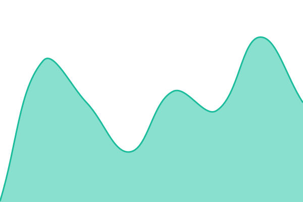
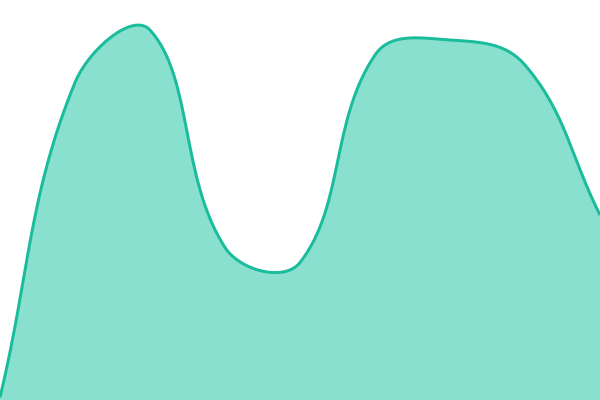

# Ground Control status

This repository contains the open-source uptime monitor and status page for [Ground Control Dev](https://status.groundcontroldev.com), powered by [Upptime](https://github.com/upptime/upptime).

<!--start: status pages-->
<!-- This summary is generated by Upptime (https://github.com/upptime/upptime) -->
<!-- Do not edit this manually, your changes will be overwritten -->
<!-- prettier-ignore -->
| URL | Status | History | Response Time | Uptime |
| --- | ------ | ------- | ------------- | ------ |
|  [Web app](https://app.groundcontroldev.com/api/health) | 🟩 Up | [web-app.yml](https://github.com/groundcontroldev/status/commits/HEAD/history/web-app.yml) | 

 577ms
     
 | 

<a href="https://status.groundcontroldev.com/history/web-app">100.00%</a>
    

|  [Database](https://app.groundcontroldev.com/api/health) | 🟩 Up | [database.yml](https://github.com/groundcontroldev/status/commits/HEAD/history/database.yml) | 

 134ms
     
 | 

<a href="https://status.groundcontroldev.com/history/database">100.00%</a>
    

|  [Sign-in](https://data.groundcontroldev.com/auth/v1/health) | 🟩 Up | [sign-in.yml](https://github.com/groundcontroldev/status/commits/HEAD/history/sign-in.yml) | 

 390ms
     
 | 

<a href="https://status.groundcontroldev.com/history/sign-in">100.00%</a>
    

|  [File storage](https://data.groundcontroldev.com/storage/v1/status) | 🟩 Up | [file-storage.yml](https://github.com/groundcontroldev/status/commits/HEAD/history/file-storage.yml) | 

 115ms
     
 | 

<a href="https://status.groundcontroldev.com/history/file-storage">100.00%</a>
    

|  [Website](https://www.groundcontroldev.com) | 🟩 Up | [website.yml](https://github.com/groundcontroldev/status/commits/HEAD/history/website.yml) | 

 238ms
     
 | 

<a href="https://status.groundcontroldev.com/history/website">100.00%</a>
    

<!--end: status pages-->

## 📄 License

- Powered by: [Upptime](https://github.com/upptime/upptime)
- Code: [MIT](./LICENSE) © [Anand Chowdhary](https://anandchowdhary.com) (Upptime)
- Data in the `./history` directory: [Open Database License](https://opendatacommons.org/licenses/odbl/1-0/)
